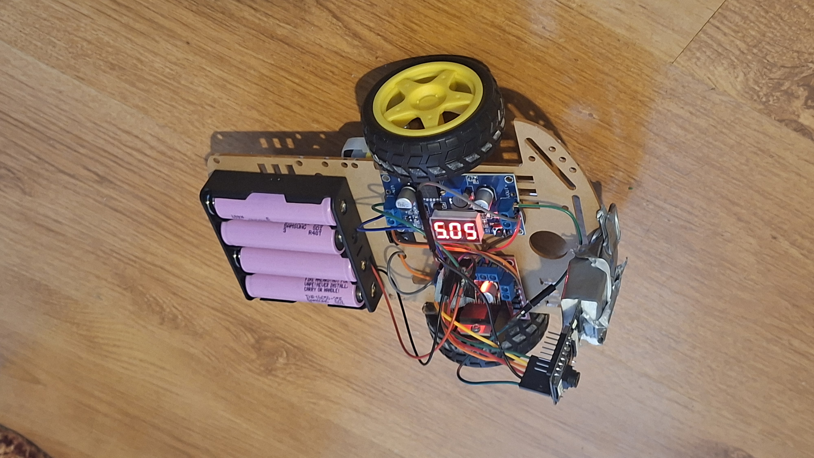
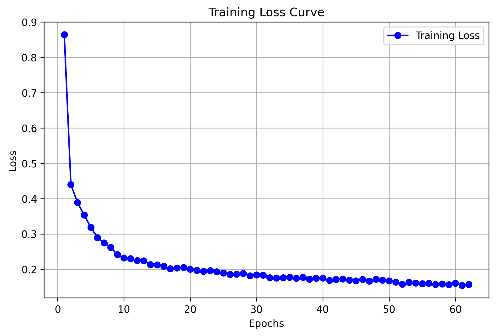

# SiamFC Object Tracker (TAILGATER-1)

This repo is an object tracking system tested on live webcam feeds and deployed to a custom (cheap and shitty) physical robot that I built, called `TAILGATER-1`.

It uses a Siamese Fully Convolutional Network (SiamFC).  

The system is split into two parts:

1. **Vision / Control (Python):** Python pipeline for dataset downloading, preprocessing, and SiamFC model training. It has two main scripts:
   * `track_webcam.py`: Runs object tracking on any PC camera feed.
   * `control_tailgater.py`: Calculates target bounding box coordinates, converts them into movement commands (`forward`, `backward`, `left`, `right`, `stop`), and sends them to the robot over Wi-Fi.
2. **Movement / Hardware (C++):** ESP32 loop (`src/main.cpp`) that receives directional commands from the Python tracker and controls the motors to keep the target centered.

## Table of Contents
- [Project Showcase](#project-showcase)
- [Robot Hardware Specs](#robot-hardware-specs)
- [Code + Repo Structure](#code--repo-structure)
- [Quick Start: Webcam Tracking](#quick-start-webcam-tracking)
- [Training Your Own SiamFC (Optional)](#training-your-own-siamfc-optional)

## PROJECT SHOWCASE!
### SiamFC tracking selected objects on my webcam:
<video src="https://raw.githubusercontent.com/horecdev/tailgater/main/media/webcam_showcase.mp4" controls playsinline></video>

### TAILGATER-1 driving into the selected target:
<video src="https://raw.githubusercontent.com/horecdev/tailgater/main/media/tailgater_showcase.mp4" controls playsinline></video>

### The Robot Itself


## Robot Hardware Specs
The total cost for the robot stays under 30$ (~110-120 PLN), excluding reusable stuff like Li-ion 18650 cells.
| Component | Description | Approx. Cost (PLN) |
| :--- | :--- | :--- |
| **Chassis Kit** | 2WD Acrylic chassis + 2x TT Gear Motors + wheels | ~30 PLN |
| **MC + Vision** | ESP32-CAM module | ~60 PLN |
| **Motor Driver** | L298N Dual H-Bridge driver | ~8 PLN |
| **Power Management** | LM2596 DC-DC Buck Converter | ~10 PLN |
| **Power Source** | 4x 18650 Li-ion batteries | ~idk |

## Code + Repo Structure
```
├── control_tailgater.py          # Runs the vision loop and sends commands over to ESP32
├── track_webcam.py               # Runs the same vision loop but on a webcam instead of ESP32-CAM
├── platformio.ini                # Config file for platformio
├── src/
│   └── main.cpp                  # ESP32 loop receiving commands and spinning motors
└── python_ml/
    ├── dataset.py                # PyTorch Dataset loader
    ├── loss.py                   # Balanced logistic loss for SiamFC
    ├── siamfc.py                 # SiamFC architecture
    ├── train.py                  # Training loop for SiamFC
    └── scripts/
        ├── download_dataset.py   # Dataset fetcher script
        └── preprocess_dataset.py # Data cropping / filtering script
```

## Quick Start: Webcam Tracking
I decided not to give instructions on how to build the robot, because I'm more into the software part, rather than the hardware. Also the robot is such a botch job it's crazy.  

You can run the webcam tracker on your PC, without training a model.  I included the `SiamFC` weights under `weights/siamfc.pth`.

### Install dependencies.
Clone the repo and install the required Python packages:
```bash
git clone https://github.com/horecdev/tailgater.git
cd tailgater
pip install torch torchvision opencv-python numpy
```
### Run the Tracker.
```bash
python track_webcam.py
```
**How to use it**: When the camera feed window opens, move your mouse and `left-click` on whatever you want to track. Use `right-click` to drop the target. Use `scroll` to adjust the selection box size. Press `q` to quit.

## Training Your Own SiamFC (Optional):

Here is how to train your own model end to end. 

### 1. Download the Dataset.
Fetches the raw dataset.
```bash
python python_ml/scripts/download_dataset.py
```
### 2. Preprocess the Data.
Crops and filters the GOT10k frames.
```bash
python python_ml/scripts/preprocess_dataset.py
```
### 3. Run the Training Loop.
Train the model :)
```bash
python python_ml/train.py
```

### 4. Pick the best model.
Pick the best model from `./train/` (epoch with lowest loss presumably) and put it in `weights/siamfc.pth` or update paths in python scripts to point to it.

### My Training Results:
I did not run this through validation benchmarks, because the goal was just to get it working for the robot and webcam. I stopped training after 61 epochs. Here is the loss curve:


